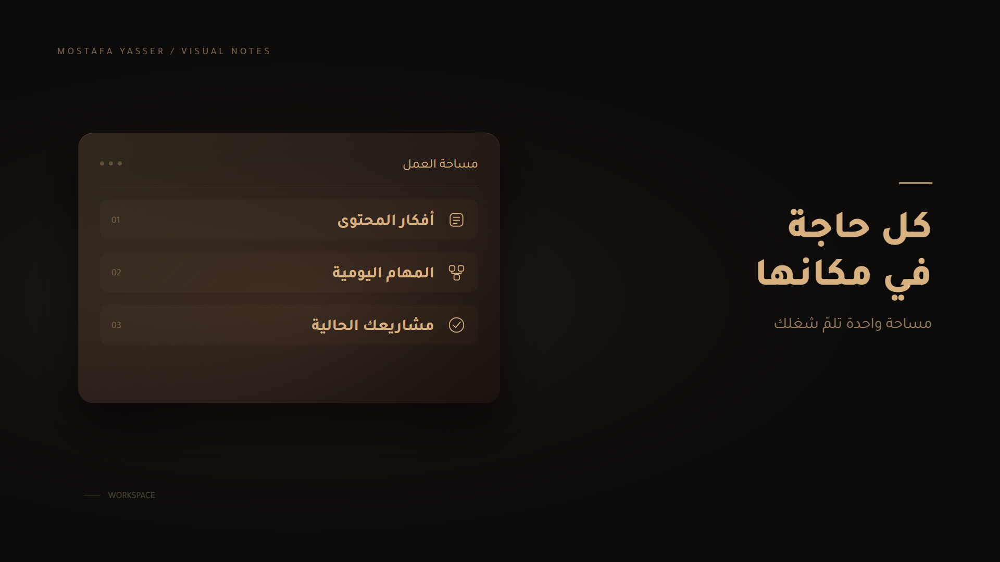

# Mostafa Motion Kit

**v0.2 — مرجع مونتاج يوتيوب وB-rolls بهوية مصطفى، مع ضيّ كشخصية أساسية.**

ابدأ من [دليل الـAI](START_HERE.md)، أو [دليل محرر يوتيوب](docs/YOUTUBE_PLAYBOOK.md). الاتجاه الجديد: عمق زجاجي، حركة كاميرا، خطوط اتصال وتحولات توضح الفكرة. [تحليل المراجع](docs/REFERENCE_STYLE.md) · [دليل ضيّ](docs/DHAYY.md).

### العينات السينمائية الجديدة

| المشهد | الفكرة | المعاينة |
| --- | --- | --- |
| ConnectedSystem | أدوات منفصلة تتجمع في نظام واحد | [MP4](previews/v2/connected-system.mp4) |
| FocusFilter | من التشتت لخطوة واحدة واضحة | [MP4](previews/v2/focus-filter.mp4) |
| DhayyAssistant | ضيّ ومساعد يحوّل الفكرة لخطة | [MP4](previews/v2/dhayy-assistant.mp4) |
| CinematicShowcase | العينات الثلاثة، 30 ثانية بالصوت | [MP4](previews/v2/cinematic-showcase.mp4) |

عينات فعلية 1080p/30fps مع مؤثرات أصلية. ضيّ في العينة صورة داخل تحريك 2.5D، وليس شخصية تتكلم أو نموذجًا متحرك الأطراف. النصوص والتوقيت التفصيلي للمشاهد الجديدة في src/cinematic/؛ التحكم في المؤثرات من Props.

مكتبة B-rolls لمصطفى ياسر: بني وذهبي، خط Tajawal، حركة تدريجية، ومؤثرات صوتية خفيفة. تُستخدم فوق تعليقك الصوتي أثناء المونتاج.

## ابعت الرابط لأي AI وابدأ

> اقرأ START_HERE.md ثم AGENTS.md وSTYLE.md في هذا الريبو. ساعدني أحوّل فكرتي أو مقطع سكريبت/صوت إلى B-roll بهوية مصطفى ياسر، مع Sound effects. استخدم القوالب أو ابنِ مشهدًا جديدًا عندما تحتاج الفكرة. نفّذ واعرض معاينة لو أدواتك تسمح؛ وإلا سلّمني خطة واضحة وملفات قابلة للتنفيذ، ووضّح ما لم تنفذه.

**للـAI:** ابدأ من [START_HERE.md](START_HERE.md). القوالب أمثلة وليست حدودًا للأفكار الممكنة. قواعد الهوية ثابتة، والمشاهد قابلة للتوسعة.

**للمونتاج:** اتبع [EDITING_WORKFLOW.md](docs/EDITING_WORKFLOW.md). الريبو يوفر قوالب وخط سير عمل؛ لا يحتوي محرر فيديو كاملًا أو محاذاة تلقائية للصوت. الـAI الذي يقرأ روابط فقط يستطيع التخطيط وكتابة الكود، لكنه يحتاج أدوات ملفات وتشغيل ورندر لإنتاج فيديو فعلي.



معاينات MP4 بالصوت: [واجهة زجاجية](previews/hero-panel.mp4) · [خطوات نظام](previews/SystemFlow.mp4) · [كروت عائمة](previews/FloatingCards.mp4).

## البداية

ثبّت Node.js LTS ومعه npm، ثم من هذا المجلد:

```sh
npm install
npm run studio
```

أو استخدم pnpm: `pnpm install --frozen-lockfile` ثم `pnpm studio`. ملف pnpm-lock.yaml يثبت الإصدارات التي اختُبرت.

اختر القالب من الشريط الجانبي. افتح Props لتغيير النصوص، مدة المشهد، سرعة كشف العناصر، وشدة المؤثرات. المعاينة لا تعدّل القيم الافتراضية تلقائيًا: احفظ التغييرات من Studio أو صدّر Props إلى ملف JSON لاستخدامه عند الرندر.

## القوالب

الجدول التالي للقوالب البسيطة الأصلية؛ للمشاهد الجديدة راجع الجدول أعلى الصفحة.

| القالب | مناسب لـ | المثال |
| --- | --- | --- |
| HeroPanel | شرح فكرة داخل واجهة رمزية | تجميع الأفكار والمهام والمشاريع |
| SystemFlow | شرح نظام من ثلاث خطوات | اجمع ← نظّم ← نفّذ |
| FloatingCards | عرض ثلاث أفكار قصيرة | هدف، خطوة، مراجعة |

كل قالب 1920×1080، بمعدل 30 إطارًا، و8 ثوانٍ افتراضيًا. المدّة بين 6 و20 ثانية. المشاهد أمثلة تصميمية؛ واجهة مساحة العمل ليست تسجيلًا حقيقيًا لمنتج.

## التصدير

```sh
npm run render -- HeroPanel out/hero-panel.mp4
npm run render -- CinematicShowcase out/showcase.mp4
npm run render -- DhayyAssistant out/dhayy.mp4
npm run render -- SystemFlow out/system-flow.mp4
npm run render -- FloatingCards out/floating-cards.mp4
npm run render -- HeroPanel out/custom.mp4 --props=examples/hero-panel.json
npm run still -- HeroPanel out/hero-panel.png --frame=120
```

النتيجة MP4 بخلفية داكنة ومؤثرات صوتية، قابلة للوضع مباشرة في برنامج المونتاج. هذه النسخة لا توفر خلفية شفافة أو مقاسًا طوليًا. لا تتضمن مولّد تعليق صوتي أو موسيقى أو محاذاة آلية للكلمات.

## الصوت والتوقيت

- `soundEffects`: تشغيل/كتم المؤثرات.
- `soundVolume`: من 0 إلى 1؛ البداية 0.22 للقوالب القديمة و0.32 للمشاهد السينمائية. اضبطه بعد سماعه مع صوتك الفعلي.
- `revealSeconds`: الفاصل بين ظهور العناصر الثلاثة، من 0.5 إلى 1.2 ثانية.
- `durationSeconds`: مدة اللقطة؛ زيادة المدة تمدّد وقفة القراءة في النهاية.
- المؤثرات مرتبطة بنفس توقيت دخول العناصر. الأصوات مُصنّعة محليًا؛ لا تعتمد على تحميل عينات خارجية.
- لإعادة توليدها: `npm run sounds`. الملفات الخمسة في `public/sfx/` ويمكن استبدالها بملفات WAV بنفس الأسماء.
- للمزامنة الدقيقة، وفّر ملف صوتك أو توقيت الجمل، ثم اطلب تعديل `timing()` في `src/config.ts`. لا تدّعي النسخة الحالية أنها تحلل صوتك تلقائيًا.

`durationSeconds` و`revealSeconds` وتعديل النصوص من Props تخص القوالب القديمة. المشاهد السينمائية مدتها 10 ثوانٍ لكل مشهد؛ تعديل نصوصها وتوقيتها يتم في `src/cinematic/` وتسجيل المدة في `src/Root.tsx`.

## اطلب لقطة بالكلام

انسخ مثالًا من [PROMPTS.md](PROMPTS.md)، أو اكتب:

> اعمل B-roll مدته 8 ثواني من Mostafa Motion Kit لفكرة «بدل ما المهام تبقى متفرقة، خليها كلها في مكان واحد». استخدم HeroPanel. صوتي هيتضاف في المونتاج، وضيف Sound effects خفيفة. ورّيني المعاينة.

## الملفات المهمة

- `STYLE.md`: دليل الهوية والحركة.
- `AGENTS.md`: قواعد العمل لأي وكيل داخل الريبو.
- `src/brand.ts`: ألوان وخامة المشاهد.
- `src/config.ts`: النصوص والتوقيت والمخطط القابل للتعديل.
- `src/Scene.tsx`: القوالب ومكوّنات الحركة والمؤثرات.
- `src/Root.tsx`: تسجيل القوالب وإعدادات التصدير.
- `public/fonts/`: خطوط محلية، مع رخصة OFL.
- `examples/`: بيانات مثال جاهزة للرندر.

## مصدر الفكرة والملكية

الفكرة التنظيمية مستلهمة من [motion-starter-kit](https://github.com/motalim-ai/motion-starter-kit). التنفيذ هنا مستقل؛ لم تُنسخ ملفات الكود أو الفيديوهات المرجعية من ذلك المشروع. الهوية مبنية على دليل مصطفى ياسر المحلي، والإيقاع والتكوين مقترحات للمراجعة.

الخطوط لها الترخيص المرفق. راجع [ترخيص Remotion](https://www.remotion.dev/license) وفق نوع استخدامك. لم يتم اختيار ترخيص مفتوح لكودك أو أصول هويتك؛ اختره عند تحديد طريقة مشاركة الريبو.

## التحقق

```sh
npm run typecheck
```

راجع الصور والمشهد المتحرك قبل استعماله: سلامة العربية، طول النص، وقت القراءة، ومستوى المؤثرات مع التعليق الصوتي. احتفظ بالعناوين قصيرة؛ المخطط يحدّ طولها لتقليل تجاوز المساحة.
